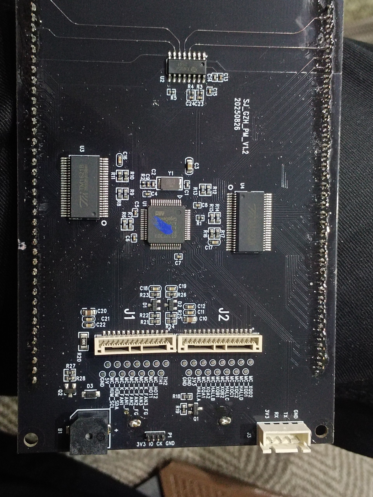
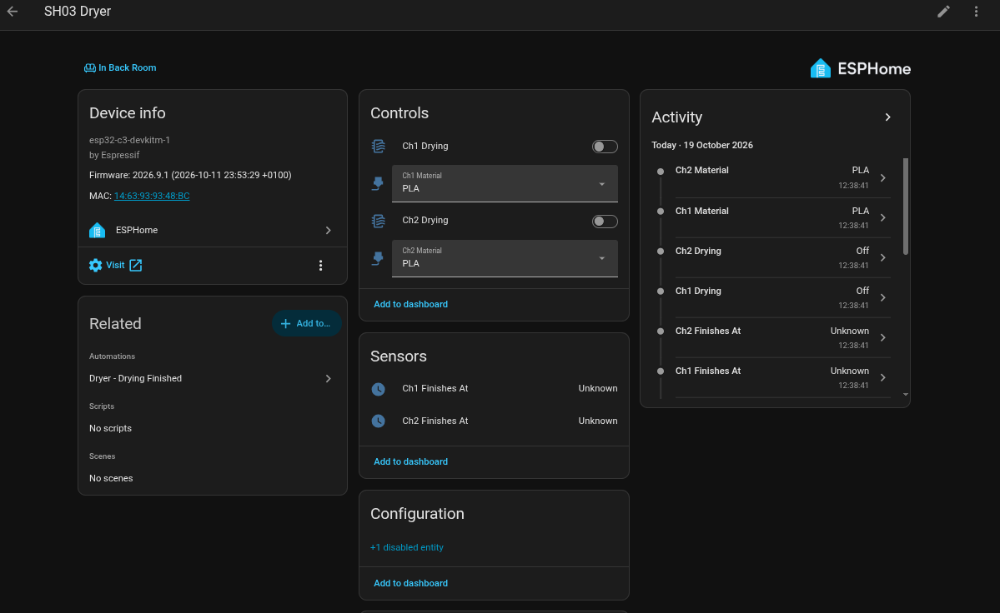
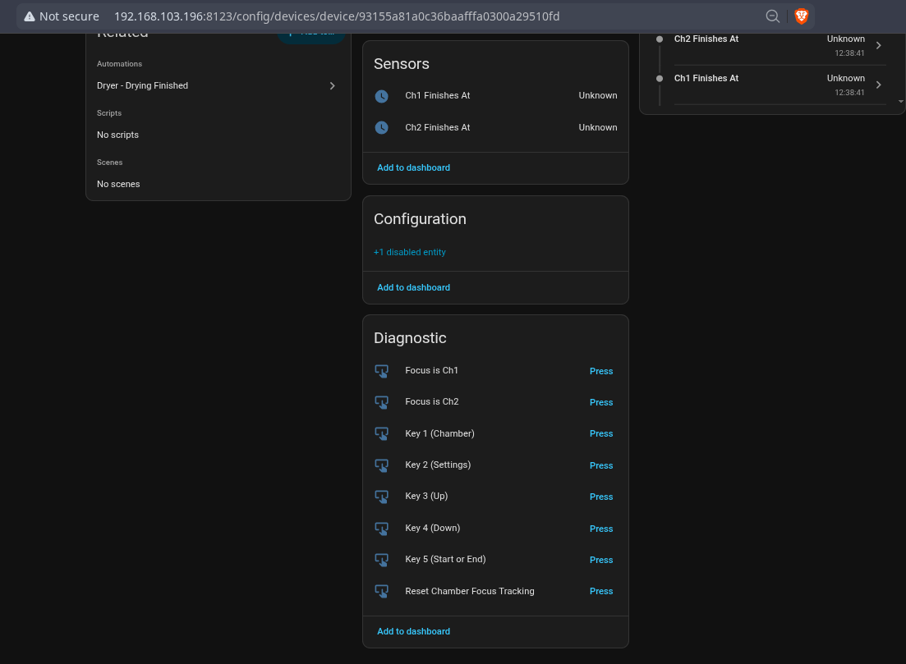

# Sovol / Comgrow SH03 filament dryer → Home Assistant

> **Disclaimer:** I am not a programmer but use AI for my benefit! If you are ok
> with it then proceed — or well, not! Also, as I have not yet received any
> permission to upload patched or original firmware from Sovol/Comgrow, you will
> have to obtain it by yourself following this guide! As Sovol is very
> Open-Source friendly they might agree for me to upload it here, so go and
> convince them!

Control a **stock** Comgrow / Sovol SH03 dual-chamber filament dryer from Home
Assistant — and, through HA, from Klipper/Moonraker and Spoolman — **without
replacing the stock firmware and without losing the physical touchscreen.**

A small patch to the dryer's own firmware makes its touch-read routine also
consume a byte from the `J3` debug UART. An ESP32-C3 running ESPHome sends the
touch code for a button, then briefly pulses the touch controller's interrupt
line to make the dryer "press" that button. Real fingers keep working exactly as
before.



How it looks in Home Assistant — the two chambers, their material selects and the
drying switches:




▶ [Working-demo video — the dryer running, driven from Home Assistant](docs/video/video_2026-10-19_13-37-28.mp4)

*More photos and clips: [`docs/images/`](docs/images/README.md).*

## Status

Working. All five panel buttons are drivable from HA; chamber focus, material
selection and start/stop are exposed as proper entities. Read
[Known issues](#known-issues) before trusting it in an automation.

## Hardware

| Part | Detail |
|---|---|
| Dryer | Comgrow / Sovol SH03 — dual independent chambers, 4 spools, 45–85 °C, 400 W |
| Dryer brain | **GigaDevice GD32F303CC** (Cortex-M4) on the screen board, `SJ_GZH_PM_V1.2` |
| Bridge | **ESP32-C3** (`esp32-c3-devkitm-1`), running ESPHome |

The screen board holds the MCU; the main board is power/driver only.

## Wiring

| ESP32-C3 | Dryer | Notes |
|---|---|---|
| GPIO4 (TX) | `J3` RX | sends the touch-code byte |
| GPIO5 (RX) | `J3` TX | optional — reads the stock debug log |
| GPIO6 | `PA3` / `U2` pin 9 | touch interrupt; open-drain, ~1 kΩ series resistor |
| GND | GND | common ground — mandatory |
| 5V | `J1` pin 2 or USB | power; not both at once |

Full detail, connector pinouts and safety notes: **[docs/WIRING.md](docs/WIRING.md)**.

> ⚠️ The screen board is the brain. With the `J1`/`J2` ribbons unplugged the
> heater driver inputs float and the **heaters can go full on**. Never power the
> dryer with the screen disconnected.

## Flashing

**1 — Dryer firmware.** One-off, via an ST-Link (SWD). This repo ships no vendor
firmware — you dump your own unit and patch it:

```bash
python3 -m pyocd pack install GD32F303CE
python3 -m pyocd cmd -t gd32f303cc -c "savemem 0x08000000 0x40000 sh03_stock.bin"
python3 firmware/patch_sh03.py sh03_stock.bin
python3 -m pyocd flash -t gd32f303cc sh03_stock_patched.bin
```

Keep `sh03_stock.bin` — it's your recovery image. Full step-by-step (SWD wiring,
verification, roll-your-own): **[docs/FLASHING.md](docs/FLASHING.md)**.

**2 — ESP32.** Ordinary ESPHome (a static IP is set in the config — worth
keeping on cloned C3 minis, whose WiFi is often marginal):

```bash
cd esphome
cp secrets.yaml.example secrets.yaml   # then edit it
esphome run sh03-dryer.yaml
```

## Entities and services

Per chamber (`Ch1` / `Ch2`):

- `select` — **ChN Material**: PLA/PET/PC/PP/PA/ASA/PIA/TPU/ABS/PETG
- `switch` — **ChN Drying**: on starts with the selected material, off stops
- `sensor` — **ChN Finishes At**: estimated completion time

HA services:

| Service | Variables | Effect |
|---|---|---|
| `esphome.<node>_sh03_start` | `chamber` (1/2), `material` (0–9) | start, or switch material if already drying |
| `esphome.<node>_sh03_stop` | `chamber` | stop |
| `esphome.<node>_sh03_set_focus` | `chamber` (0 = unknown) | tell the ESP which chamber the panel is on |
| `esphome.<node>_sh03_resync` | `chamber`, `material`, `running` | resync tracked state after manual use |

All key traffic goes through one queued script, so concurrent automations run
one after another instead of fighting over the single UART/touch line.

## How it works

1. The stock firmware maps a raw touch code to a key via a table at
   `0x0800b3a6`. Key codes: `1`=E7 chamber, `2`=F7 settings, `3`=FB up,
   `4`=F9 down, `5`=FC start/stop, `6`=F8 unused.
2. The entry of `XW05A_Get_TouchCode` (`0x0800b358`) is redirected to a veneer
   at `0x08012000`. The veneer checks UART3 (`0x40004C00`) for a waiting byte;
   if there is one it uses it as the touch code, otherwise it falls through to
   the real XW05A I²C read.
3. Touch reads are edge-driven (XW05A INT on `PA3`). The ESP32 sends the key
   byte on `J3` RX, then pulses `PA3` low for ~60 ms to trigger a read.

Full reverse-engineering notes: **[docs/PROTOCOL.md](docs/PROTOCOL.md)**.

## Repository layout

```
esphome/     sh03-dryer.yaml (working config) + secrets example
firmware/    patch_sh03.py — applies the firmware patch to your own dump
docs/        WIRING, FLASHING, PROTOCOL, the SH03 manual, photos + video
```

## Known issues

- **Drying switch fires a stop at boot.** Both `ChN Drying` switches use the
  template-switch default `restore_mode: ALWAYS_OFF`, so `setup()` calls
  `turn_off()`, triggering `turn_off_action` → `run_job(stop)`. On a warm reboot
  (OTA) while drying, the restored `running_*` flag is still true and the boot
  stop sequence is sent — **an OTA update will stop a running cycle.** Fix: add
  `restore_mode: DISABLED` to both switches.
- **Open loop.** The dryer gives no state readback, so anything done on the
  physical panel desyncs the ESP's tracked state. Use `sh03_resync` (or the
  diagnostic buttons) after manual use.
- **`Finishes At` is an estimate**, derived from per-material default times —
  the dryer keeps running regardless.
- **Chamber focus is a 2-state toggle** (Ch1 ↔ Ch2); the stop sequence relies on
  an even number of Key-1 presses returning to the same chamber.
- **No temperature/humidity telemetry yet.** The `J3` console is a printf-only
  debug log with no periodic readings.

## Contributing — please help!

This project works, but it is far from perfect, and it was put together by
someone learning as they go. **Bug reports, fixes and improvements are very
welcome.**

The big thing to understand is that **the dryer gives us no feedback.** We only
*send* touch commands down the `J3` UART — we never read back what the dryer is
actually doing. Everything the ESP knows (which chamber is focused, which
material is selected, whether a chamber is running) is tracked in software. So:

- if someone uses the **physical touchscreen**, that tracking drifts out of sync;
- buttons can occasionally do the wrong thing, or send the wrong number of
  presses, depending on what state the dryer was really in;
- the material position and "finishes at" values are estimates, not readings.

If you hit a bug, an odd button behaviour, or a timing that needs tuning on your
unit, please [open an issue](https://github.com/speed007/sovol-sh03-dryer/issues)
— even a rough description helps.

Ideas that would genuinely move the project forward:

- **Readback / telemetry.** Anything that lets us *read* the dryer's real state —
  a second firmware patch that prints the chamber state on `J3` TX, or an I²C tap
  on the GXHT30 humidity sensor — would remove most of the guesswork.
- **Robustness.** Better handling of the open-loop state: re-syncing, sanity
  checks, and per-unit tuning of `touch_pulse` / `key_gap`.
- **Klipper / Spoolman glue.** Home Assistant automations that pick a material
  from the active spool, mark a spool as "in dryer", and so on. *(I already have
  this in the works, using **NFC tags** on the spools — so there's momentum here
  to build on.)*
- **Docs and photos** for other firmware revisions, or a clearer teardown guide.

Pull requests are welcome — small and focused ones are easiest to review. Not
sure where to start? Just open an issue and we'll figure it out together.

## Credits

Reverse-engineered, patched and wired by me. Built with
[ESPHome](https://esphome.io/) and [pyOCD](https://pyocd.io/).

## Disclaimer

Unaffiliated with Comgrow, Sovol or GigaDevice. Ships no vendor firmware — just
a patch script you apply to your own dump; see [`NOTICE`](NOTICE). Modifying and
reflashing a mains-powered appliance is done entirely at your own risk.

## Licence

MIT — see [`LICENSE`](LICENSE). Third-party material (the product manual and one
retailer photo) is covered by [`NOTICE`](NOTICE), not MIT.
