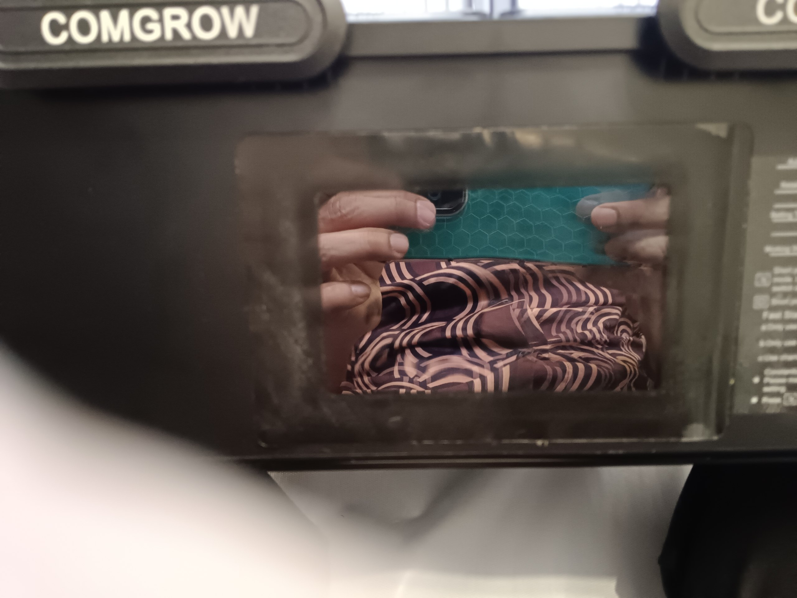
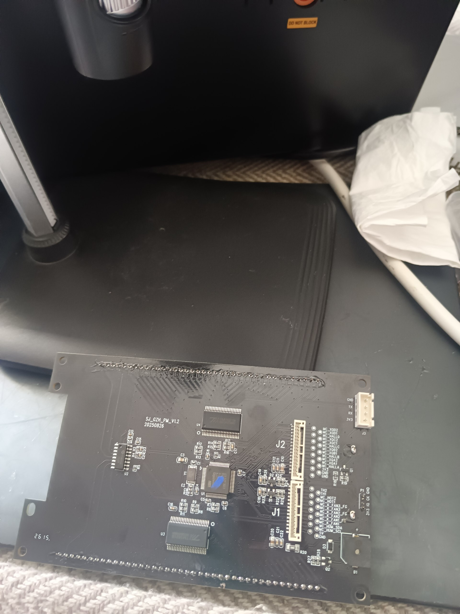
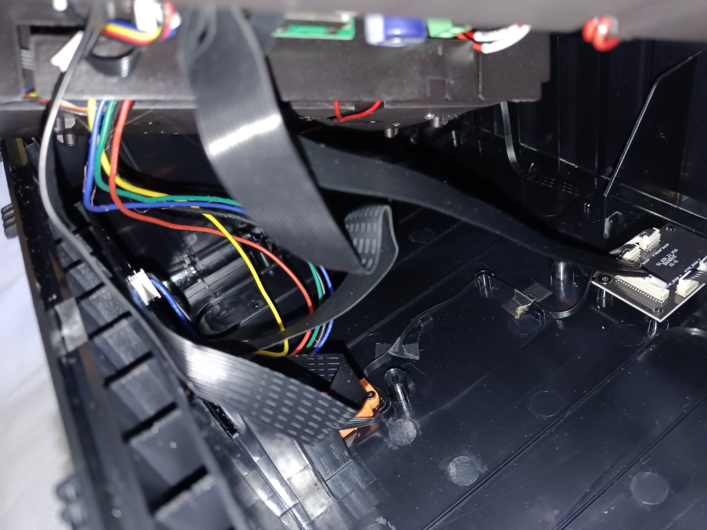
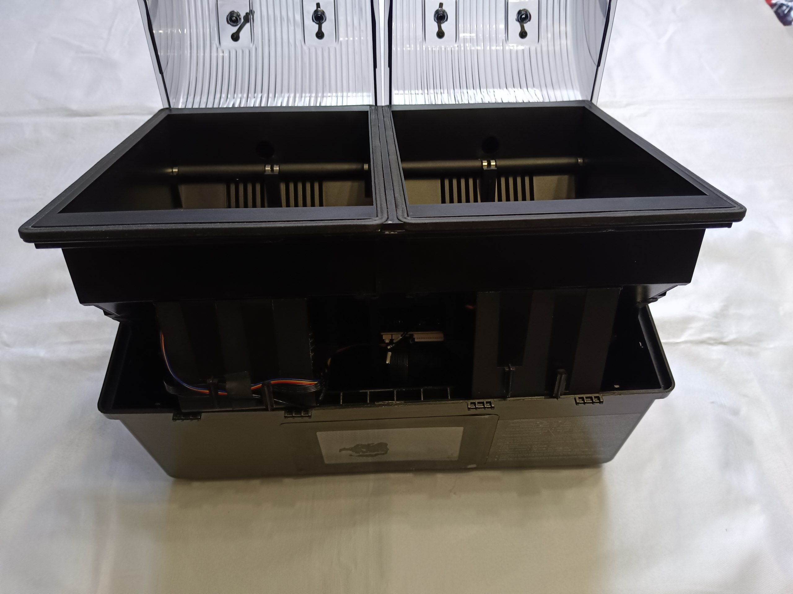
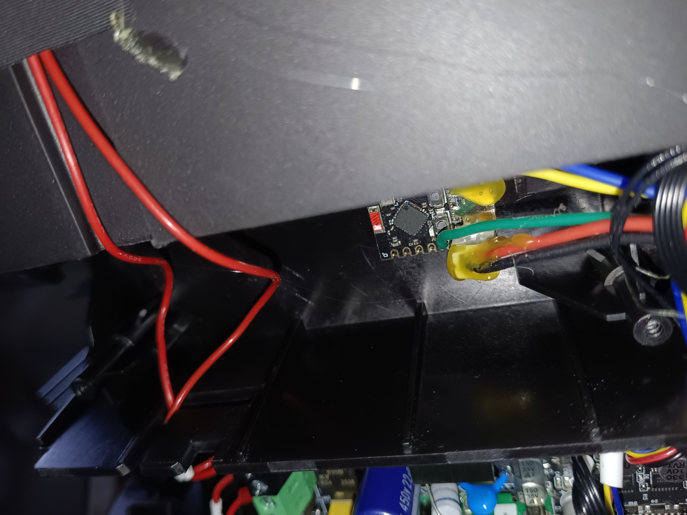
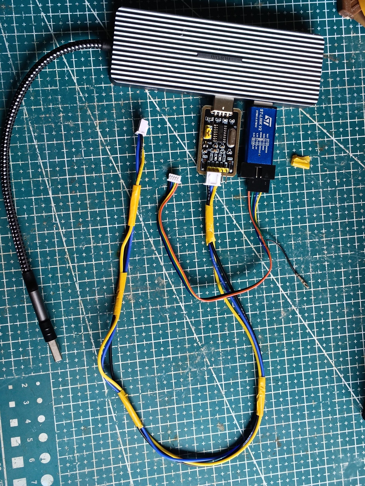
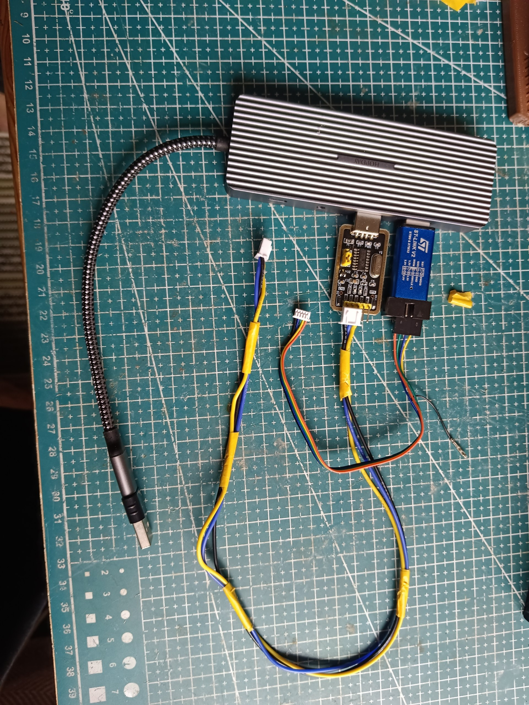
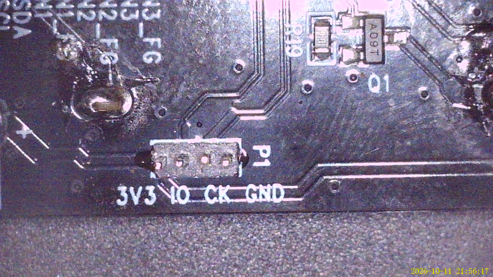
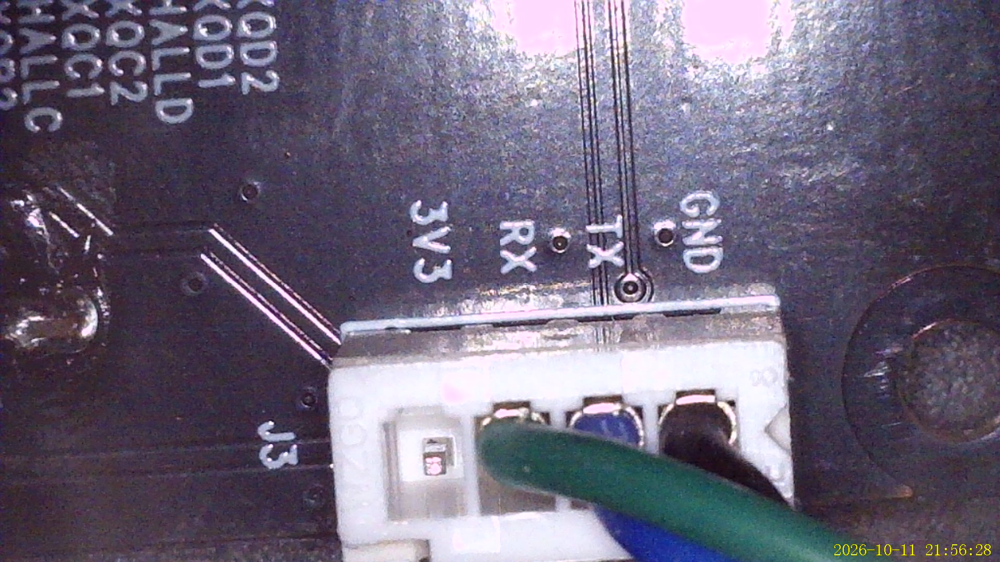

# Flashing the dryer firmware

The SH03's own firmware has to be patched before it will accept touch codes over
the `J3` UART. This is a **one-off** step, and you do it to **your own dump** —
this repository ships no vendor firmware, only `patch_sh03.py` (the 48 bytes the
patch changes).

> ⚠️ **This voids your warranty.** The screen board lives behind the screen, and
> there is **no way to reach it without pulling the screen out of the front** —
> the display's top layer has to come off first. If you're not comfortable doing
> that, stop here.

> ⚠️ **Mains appliance.** Work on it unplugged from mains where you can, and
> never power it with the screen ribbons (`J1`/`J2`) disconnected — the heater
> driver inputs float and the heaters can go full on.

## Getting to the screen board

The screen sits behind a top layer that must be removed to get at it; the board
then lifts out of the front of the unit. There's no side or rear access.




Inside the case, for orientation:




The ESP32-C3 ends up tucked inside the case (here held with hot glue):



## What you need

- An **ST-Link V2** (or clone) — the SWD programmer.
- Optionally a **CH340** (3.3 V USB-serial) — for the serial console while
  developing; not needed just to flash.
- `pyocd` on your PC:

  ```bash
  pip install pyocd
  python3 -m pyocd pack install GD32F303CE   # GigaDevice flash algorithm
  ```

  OpenOCD's generic `stm32f1x` driver does **not** work on this part.

## Bench setup

Plug the ST-Link **and** the CH340 into the same USB hub — keeping both attached
makes life much easier when you want to flash and watch the serial console
without swapping cables.




## Connect the ST-Link (`P1`)

The SWD pads are on the screen board at **`P1`**, labelled `3V3 IO CK GND`.

| ST-Link | P1  | Notes |
|---------|-----|-------|
| GND     | GND | connect first |
| SWDIO   | IO  | |
| SWCLK   | CK  | |
| 3.3V    | 3V3 | powers the board when it's on the bench |



## Connect the CH340 (`J3`) — development only

If you want the serial console (boot log, test bytes), wire the CH340 to `J3`:
`3V3 RX TX GND`. You only need this while developing — the end user flashing the
patched image doesn't.




## Power

- Feed the board from **one source only** — the **ST-Link *or* the CH340**,
  never both.
- **If the screen is attached to the dryer** (`J1`/`J2` ribbons on), **don't
  feed USB power at all** — the ribbons already power the screen board.
- For bench flashing, the screen board **standalone** (ribbons off, dryer
  unpowered) runs fine on the ST-Link's USB 3.3 V — that's the easy, safe route.
  If your ST-Link's 3.3 V browns out, power the dryer normally instead.

## 1. Dump your stock firmware — keep this, it's your backup

```bash
python3 -m pyocd cmd -t gd32f303cc -c "savemem 0x08000000 0x40000 sh03_stock.bin"
```

That writes the first 256 KiB of flash, which is all this part has. **Keep
`sh03_stock.bin`** — it's your recovery image.

## 2. Patch it

```bash
python3 firmware/patch_sh03.py sh03_stock.bin
# -> sh03_stock_patched.bin
```

The script checks the exact stock bytes it's about to change, so it **fails
loudly** if your unit is a different firmware revision rather than silently
corrupting it. (Pass `--force` only if you've verified the offsets against
[`PROTOCOL.md`](PROTOCOL.md) yourself.)

## 3. Flash

```bash
python3 -m pyocd flash -t gd32f303cc sh03_stock_patched.bin
```

- The target is **`gd32f303cc`** — the CC part (256 KB flash). The `CE` target
  faults, because its flash algorithm expects 64 KB of RAM.
- A harmless SVD parse warning from pyOCD can be ignored.

## Verify

Power-cycle the dryer. With the CH340 on `J3` (115200 8N1) you can watch the
boot banner:

```
Frimware Version: V3.5.1
FreeRTOS Version: V11.1.0
Init_Task create successed
```

(The vendor's "Frimware" typo is real.) Once patched, sending the key byte `E7`
on `J3` RX and pulsing `PA3` low switches the chamber — that's exactly what the
ESP32 does.

## Recovery — put the original back

```bash
python3 -m pyocd flash -t gd32f303cc sh03_stock.bin
```

## What the patch changes

| Offset    | Stock             | Patched          | What |
|-----------|-------------------|------------------|------|
| `0x0b358` | `80 b5 84 b0`     | `06 f0 52 be`    | touch-read entry → `b.w 0x08012000` |
| `0x12000` | `ff` × 44         | `80 b5 84 b0 …`  | veneer: poll UART3 `RBNE`, else fall through to the XW05A I²C read |

Applied to a stock V3.5.1 image, the first 256 KiB hashes to
`f116c9a110905f0fdb1735524d5b306b32993ac0f72b5f65060a7d990805369f`.

## Side note — rolling your own patch

If you want to reverse-engineer a *different* firmware revision yourself, the
**CH340** on `J3` plus the notes in [`PROTOCOL.md`](PROTOCOL.md) are what you
need. The CH340 is a development tool only.

## ESP32 side

Flashing the ESP32-C3 is a separate, ordinary ESPHome job — see the main
[README](../README.md#flashing) and [`WIRING.md`](WIRING.md).
