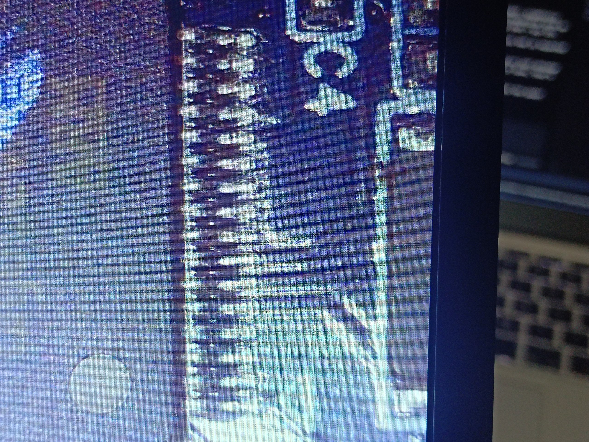

# Wiring

## ESP32-C3 ↔ dryer — the finished connection

This is all that's needed once the patched firmware is flashed.

| ESP32-C3  | Dryer                    | Notes |
|-----------|--------------------------|-------|
| GPIO4 (TX)| `J3` RX                  | sends the touch-code byte |
| GPIO5 (RX)| `J3` TX                  | optional — reads the stock debug log |
| GPIO6     | `PA3` / `U2` pin 9       | touch interrupt; open-drain, ~1 kΩ series resistor |
| GND       | GND                      | common ground — **mandatory** |
| 5V        | `J1` pin 2 (before the 30 Ω) *or* USB | power the ESP32; do not use both at once |

### Notes

- **`J3`** is `3V3 RX TX GND` on the screen board. It is the debug UART, 3.3 V
  logic, 115200 8N1.
- **`PA3`** is the XW05A touch controller's INT line (`U2` pin 9). Touch reads
  are edge-triggered, so the ESP32 pulls it low for ~60 ms to make the dryer
  read the byte it just sent. GPIO6 is configured **open-drain**, so it only
  ever pulls the line low — it never drives against the touch chip.
- Keep the pulse **short** (~60 ms). A long hold desyncs the stock touch state
  machine, after which physical touches only click.
- Power the ESP32 from the dryer's 5 V (`J1` pin 2, before the 30 Ω resistor)
  **or** USB — never both at the same time. A bare ESP32-C3 module is fine; a
  dev board with WiFi bursts may brown out on a weak 5 V rail.

## Connector reference

| Connector | Pads | Use |
|-----------|------|-----|
| `J1` | `GND, 5V, MC_HUM_SCL, MC_HUM_SDA, MC_K_FAN1…, MC_HOT1/2, TH1/2` | power board ribbon — **5 V here**, and the humidity sensor's I²C |
| `J2` | `GND, 3V3, MC_HALLx, MC_XQx1/2` | spool motors + hall sensors |
| `J3` | `3V3 RX TX GND` | debug UART — the ESP32 and the CH340 attach here |
| `P1` | `3V3 IO CK GND` | SWD — the ST-Link attaches here (see [FLASHING.md](FLASHING.md)) |

The full `J1`/`J2` pin tables are in [`PROTOCOL.md`](PROTOCOL.md#screen-board-sj_gzh_pm_v12-20250826--the-brain).

## Safety

- The screen board is the **brain**. With `J1`/`J2` unplugged the heater driver
  inputs float and the **heaters can go full on**. Never power the dryer with
  the screen disconnected.
- It's a mains appliance. Do your wiring with it unplugged, keep the low-voltage
  side away from the mains side, and double-check before first power-up.
