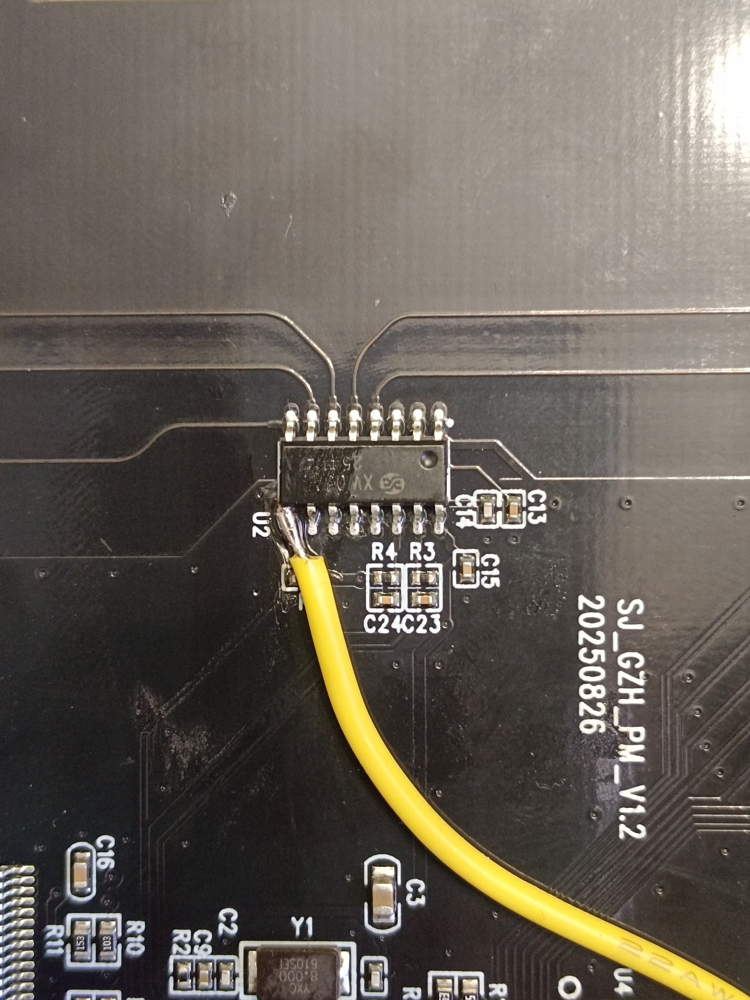
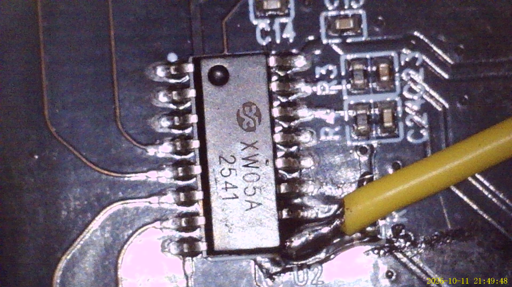
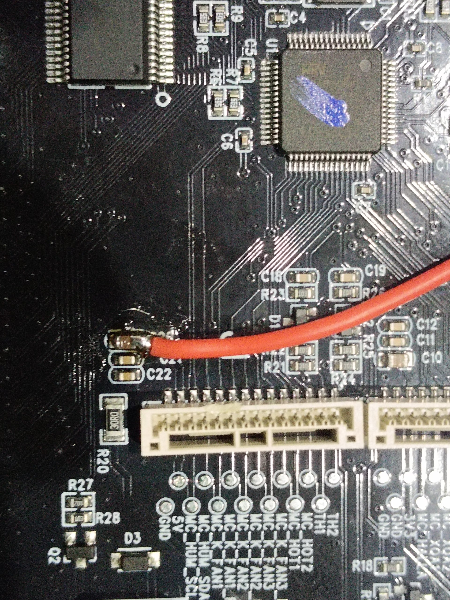
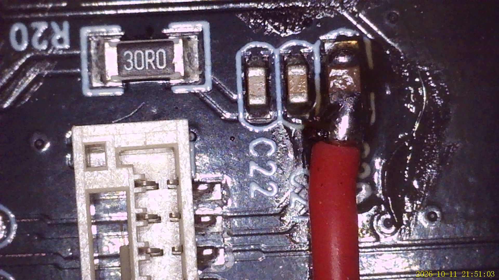
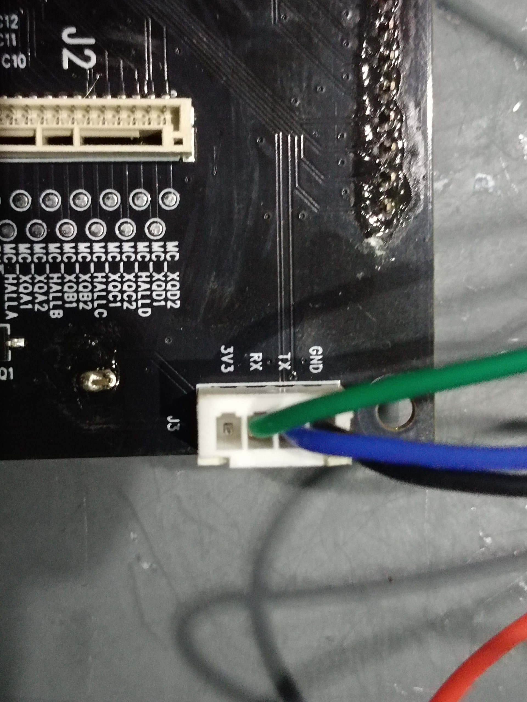
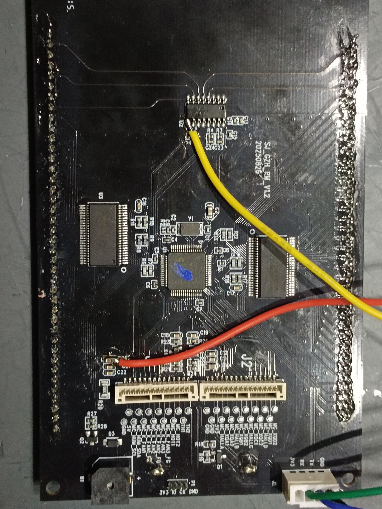
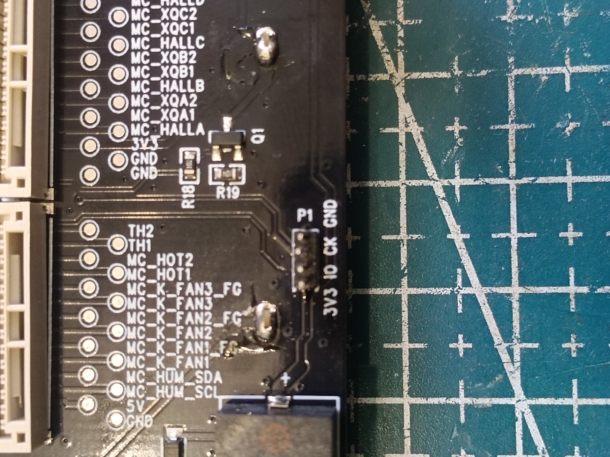

# Wiring

## ESP32-C3 ↔ dryer — the finished connection

| ESP32-C3   | Dryer                  | Notes |
|------------|------------------------|-------|
| GPIO4 (TX) | `J3` RX                | sends the touch-code byte |
| GPIO5 (RX) | `J3` TX                | optional — reads the stock debug log |
| GPIO6      | `U2` pin 9 (PA3)       | touch interrupt; open-drain, ~1 kΩ series resistor |
| GND        | GND                    | common ground — **mandatory** |
| 5V         | capacitor **C20** on the screen board | power; see [Power](#power) |

### Where to solder

**PA3 — the touch interrupt (GPIO6).** This net runs from the XW05A touch
controller's **U2 pin 9** to the MCU's **GD32 pin 17 (PA3)**. Solder to
**U2 pin 9**: the MCU's pin 17 is far too small to work on reliably.

**5 V — power (C20).** 5 V is tapped from capacitor **C20** on the screen board.

**`J3` — the serial link (3V3 / RX / TX / GND).** The ESP32's UART goes here;
so does the CH340 when developing.

The finished, modified screen board (yellow = U2 pin 9, red = C20 5 V, green/blue
= `J3`):

### Notes

- **`J3`** is `3V3 RX TX GND` on the screen board — a 3.3 V debug UART, 115200
  8N1.
- **`PA3`** is the XW05A touch controller's INT line. Touch reads are
  edge-triggered, so the ESP32 pulls it low for ~60 ms to make the dryer read the
  byte it just sent. GPIO6 is configured **open-drain**, so it only ever pulls
  the line low — it never drives against the touch chip.
- Keep the pulse **short** (~60 ms). A long hold desyncs the stock touch state
  machine, after which physical touches only click.

## Connector reference

| Connector | Pads | Use |
|-----------|------|-----|
| `J1` | `GND, 5V, MC_HUM_SCL, MC_HUM_SDA, MC_K_FAN1…, MC_HOT1/2, TH1/2` | power board ribbon — **5 V** and the humidity sensor's I²C |
| `J2` | `GND, 3V3, MC_HALLx, MC_XQx1/2` | spool motors + hall sensors |
| `J3` | `3V3 RX TX GND` | debug UART — the ESP32 and the CH340 attach here |
| `P1` | `3V3 IO CK GND` | SWD — the ST-Link attaches here (see [FLASHING.md](FLASHING.md)) |

The silkscreen labels for `J1`, `J2`, `P1` and `J3` are all visible here:

The full `J1`/`J2` pin tables are in
[`PROTOCOL.md`](PROTOCOL.md#screen-board-sj_gzh_pm_v12-20250826--the-brain).

## Power

- Feed the board from **one source only** — the **ST-Link *or* the CH340**,
  never both at once.
- **If the screen is attached to the dryer** (the `J1`/`J2` ribbons are on),
  **do not feed USB power at all** — the ribbons already bring power to the
  screen board.
- Only with the screen board **standalone** (ribbons off, dryer unpowered) do
  you power it from the ST-Link/CH340's USB 3.3 V — that's the neat way to flash
  it on the bench.

## Safety

- The screen board is the **brain**. With `J1`/`J2` unplugged the heater driver
  inputs float and the **heaters can go full on**. Never power the dryer with
  the screen disconnected.
- It's a mains appliance. Do your wiring unplugged, keep the low-voltage side
  away from the mains side, and double-check before first power-up.
